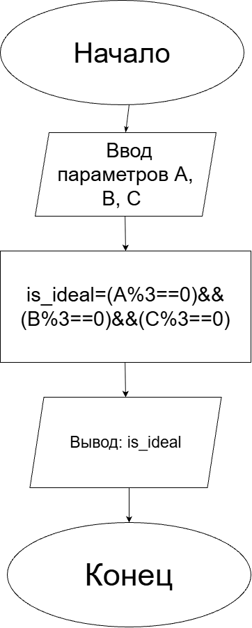
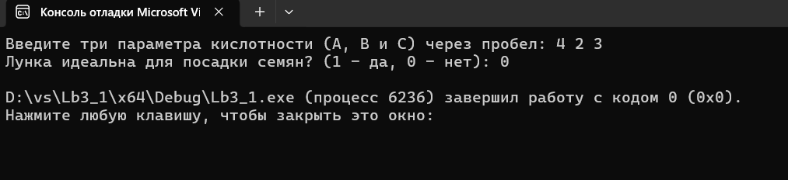
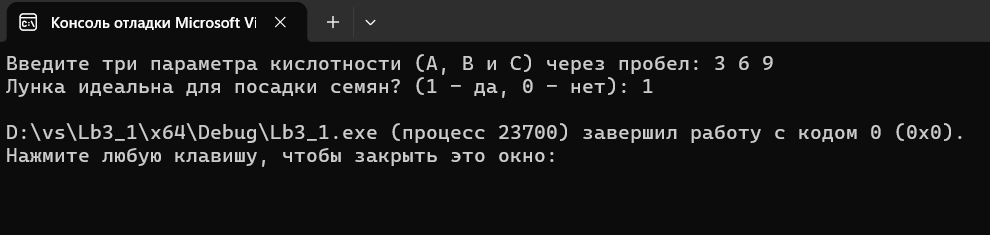

 <h1>Домашнее задание к работе 3_1 </h1>

## Условие задачи
Садовод-робот сажает семена в лунки. Лунка считается "идеальной" для посадки, если все три измеренных параметра кислотности почвы (A, B, C) кратны трем. Запишите условие для "идеальной" лунки.
## Принцип решения задачи
Проверить кратность трем всех трех лунок и если она истина, то легка подходит.
1. <b>Алгоритм и блок-схема </b>  
<i>Алгоритм</i> 
 1) Начало
 2) Объявление констант: 
  * int A, B, C;
  * int is_ideal;

3) Ввод уровня кислотности 
printf("Введите три параметра кислотности (A, B и C) через пробел: "); 
scanf("%d %d %d", &A, &B, &C); 

4) Проверка уровня кислотности (кратности трем) 
is_ideal = (A % 3 == 0) && (B % 3 == 0) && (C % 3 == 0); 

5) 	Вывод результата решения 
printf("Лунка идеальна для посадки семян? (1 - да, 0 - нет): %d\n", is_ideal);

6) Конец 
<i>Блок-схема</i> 
 

2. <b>Реализация программы</b> 
#define _CRT_SECURE_NO_WARNINGS  
#include <stdio.h> 
#include <locale.h> 
int main(void) { 
    setlocale(LC_ALL, ".UTF8"); 
    int A, B, C; 
    int is_ideal; 
    printf("Введите три параметра кислотности (A, B и C) через пробел: "); 
    scanf("%d %d %d", &A, &B, &C); 
    is_ideal = (A % 3 == 0) && (B % 3 == 0) && (C % 3 == 0); 
    printf("Лунка идеальна для посадки семян? (1 - да, 0 - нет): %d\n", is_ideal); 
    return 0; 
};

3. <b>Результат работы программы</b> 
 
 

4. <b>Информация о разработчике</b> 
Выполнила работу: Кучеренко Дарья, гр.бИЦТ-261, вариант 16